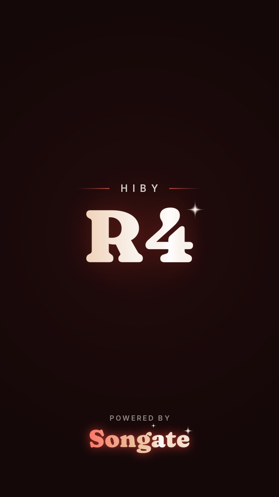
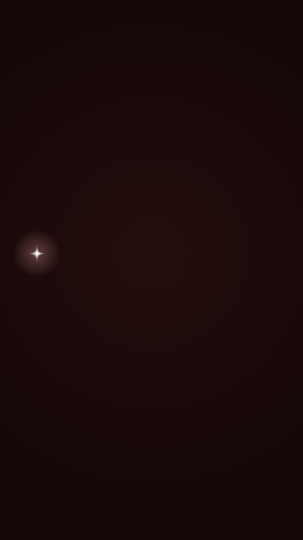
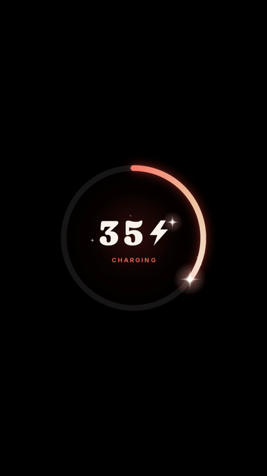

# SongateOS for the HiBy R4

**SongateOS** turns the **HiBy R4** digital audio player into a modern Android player built around
[Songate](https://github.com/AndryTheBeast/Songate), the music app, as its launcher. The whole device follows Songate's
look, from the first screen at power-on to the boot animation and the charging screen.

  
  &nbsp;
  
  &nbsp;
  

> **Work in progress, private for now.** Nothing here is ready for general use yet.
>
> **HiBy R4 standard model only** (Qualcomm SM6125, eMMC). **Not for the R4 EVA** or other HiBy players.

## What you get

| | |
|---|---|
| **Songate as the home screen** | starts straight into the music app, no second launcher |
| **HiBy audio** | the HiBy DAC (ES9018C2M) on 3.5 mm and 4.4 mm, gain, filters, balance, line out, equalizer |
| **Bit-perfect** | on 3.5 mm and 4.4 mm, up to 384 kHz, with the volume done in the DAC; Tidal MQA is decoded by HiBy's driver |
| **Status lights** | colour LED and back light: notifications, low battery, charging, audio quality colour, bass pulse |
| **Bluetooth audio** | works (tested with AAC); more codecs to be checked |
| **SongateOS look** | boot logo, boot animation and charging animation in Songate's style |
| **Custom recovery** | TWRP or OrangeFox, your choice |

## Guides

1. [Back up your R4 with EDL](docs/01-backup-edl.md): a complete, verified copy of your own firmware. **Do this first.**
2. [Install a custom recovery](docs/02-recovery.md): TWRP or OrangeFox. Downloads: [Releases](https://github.com/AndryTheBeast/SongateOS-HiBy_R4/releases).
3. [Install SongateOS](docs/03-install-os.md): the OS, the boot logo and the boot animation in one install. *(Outline: the OS isn't released yet.)*
4. [Boot logo and animations](docs/04-branding.md): how they're made, and how to go back to HiBy's. *(Outline.)*
5. [Audio: bit-perfect, DAC volume and MQA](docs/05-audio.md): how sound reaches the DAC untouched, and what was changed.
6. [Root with Magisk](docs/06-root-magisk.md): root on HiBy's firmware or on SongateOS, and how to remove it.
7. [Back to stock](docs/07-back-to-stock.md): return to HiBy's firmware from your own backup.

## Repository

| Folder | What's in it |
|---|---|
| [`device/hiby/R4`](device/hiby/R4) | Recovery device tree: builds TWRP (twrp-12.1) and OrangeFox (fox_12.1) |
| [`branding`](branding) | Generators for the boot logo, low-battery screens, boot animation and charging animation, plus the boot logo image builder |
| [`system`](system) | The system module: HiBy DAC outputs and settings, lights, Bluetooth fix, wired bit-perfect with DAC volume, the HiBy R4 service and Settings pages, and a tool that patches your own device's audio libraries |
| [`docs`](docs) | The guides |

Not included, on purpose: HiBy or Qualcomm firmware files (stock images, the EDL loader, HiBy's audio libraries,
also not in patched form: `system/patches/patch_libs.sh` patches your own copy)
and anyone's personal backup. You make and keep **your own** backup (guide 1).

## Safety rules (read before touching your player)

- **Back up first**, with EDL, and check the backup's checksums before you rely on it.
- **Never flash a backup from another unit** onto yours, and never flash images made for another device.
- **Never relock the bootloader** with modified images on it.
- **Stay on slot a.** On many units slot b has no system; switching to it leaves the player unbootable.
- The protected partitions (xbl, tz, abl, rpm, hyp, devcfg, keymaster, persist, modem, devinfo, frp, …) are never
  written by anything in this project.

## Credits

- Device tree, OS work, Songate: **AndryTheBeast**
- [TWRP](https://twrp.me), [OrangeFox Recovery](https://orangefox.download), [LineageOS](https://lineageos.org),
  [TrebleDroid](https://github.com/TrebleDroid)
- Fonts: Fraunces and Inter, both SIL Open Font License (`branding/fonts`)
- HiBy for the hardware. The kernel is HiBy's prebuilt (their kernel source isn't published).

## License

Apache-2.0 for this project's own files. Fonts: SIL OFL 1.1. Prebuilt kernel: GPL-2.0 (HiBy).
